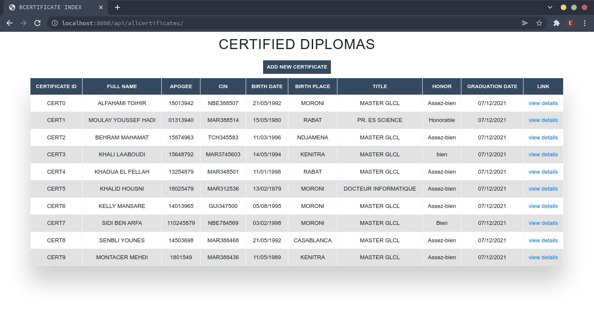
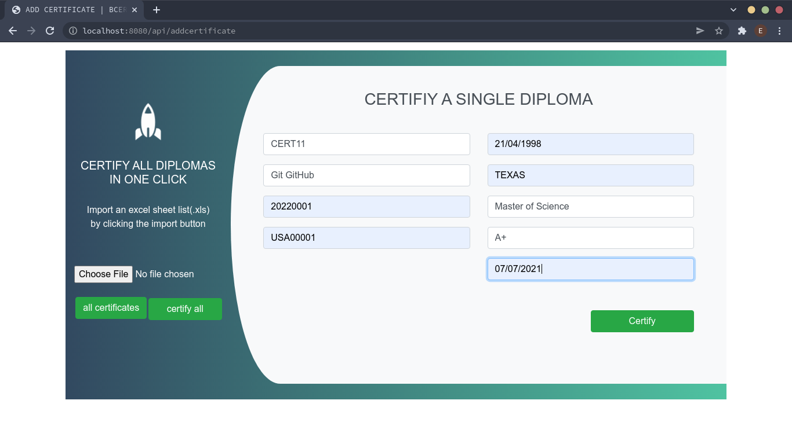
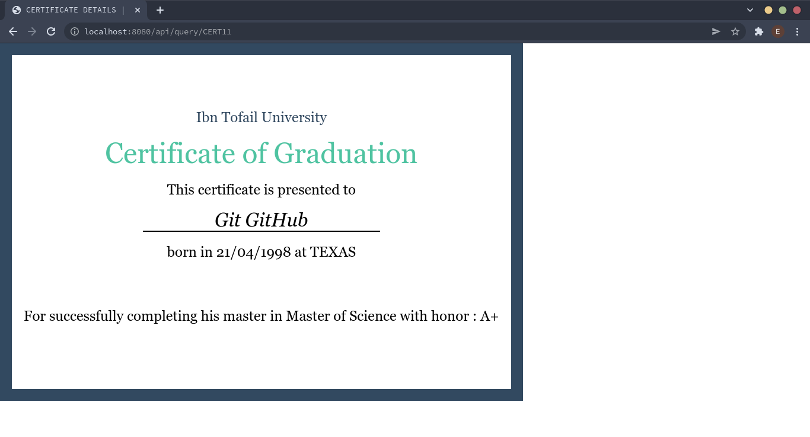

# Introducción rápida
📖 Este proyecto está documentado en detalle en <a href="https://codelogium.github.io/projects/blockchain/bcertificate/" target="_blank">Codelogium</a>, cubriendo la arquitectura, cómo funciona, instrucciones de configuración y los principales aprendizajes.

**BCertificate** es una aplicación completa de blockchain de Hyperledger que automatiza la emisión, distribución y gestión de credenciales digitales universitarias (diplomas, competencias, historiales académicos, certificaciones de grado, etc).

Una red de blockchain que permite a escuelas, colegios y universidades agregar sus credenciales en la cadena de bloques, lo cual podría ayudar a combatir documentos fraudulentos.

La red fue construida utilizando [Hyperledger Fabric V2.X.X](https://www.hyperledger.org/use/fabric) y las pruebas se realizaron en máquinas **_Linux/Debian 10 Buster_**, **_WSL/Debian 10 Buster_** y **_WSL/Ubuntu_**, pero debería funcionar en cualquier sistema operativo.
 
La aplicación web está construida con **_NodeJS_**, **_ExpressJS_**, **_REST API_** y el motor de plantillas **pug** para la renderización del front-end.

## Configuración y ejecución
_**NB:** Tener **_docker_** instalado en tu sistema operativo es **OBLIGATORIO**_.

**TL;DR** : _si estás familiarizado con Hyperledger Fabric y tienes todo lo necesario configurado para ejecutarlo, dirígete a _**certificate-network/certificate-starter/**_ y [ejecuta la red](#commands-execute)_.

Si nunca has trabajado con Hyperledger Fabric antes, querrás obtener la versión que se ajuste mejor a este proyecto. 
Descarga el [código fuente del repositorio fabric-samples versión-2.0.0](https://github.com/hyperledger/fabric-samples/releases/tag/v2.0.0-beta) o obténlo desde mi [fork fabric-sample 2021](https://github.com/alfahami/fabric-samples) y haz lo siguiente:

**BCertificate** se construye sobre la base de Hyperledger Linux, por lo que es obligatorio instalar y configurar Hyperledger primero.

### Instalación y configuración de Hyperledger

*Prerrequisitos*:
  - Instala y configura Docker (hay muchos tutoriales en la web, )
  - Instala curl (`sudo apt update && sudo apt upgrade` y luego `sudo apt install curl` en una máquina Linux)

*Hyperledger*:
  - Ejecuta este único comando para descargar e instalar las muestras, binarios e imágenes de Docker de la última versión de producción de HL:

  - `curl -sSL https://bit.ly/2ysbOFE | bash -s`
  - si el enlace anterior no funciona, descarga el [código fuente del repositorio fabric-samples versión-2.0.0](https://github.com/hyperledger/fabric-samples/releases/tag/v2.0.0-beta)
  - Encuentra más detalles en la [documentación oficial de HL](https://hyperledger-fabric.readthedocs.io/en/release-2.2/install.html)
  - Ejecuta la red de prueba según se describe en el [tutorial de uso de la test-network](https://hyperledger-fabric.readthedocs.io/en/release-2.2/test_network.html) para asegurarte de que todo esté configurado.

### BCertificate, instalación y ejecución
Ahora, ¿cómo iniciamos nuestra red de HL y hacemos que nuestra aplicación web funcione?

Antes que nada, descarga o clona este repositorio.\
Estructura del repositorio:
   - **_certificate-network/_** : contiene nuestra aplicación completa de blockchain. Incluye nuestros archivos de configuración, materiales criptográficos, aplicación inicial, chaincode, etc.
  <blockquote>
  
  Dado que Hyperledger ha cambiado el contenido y la estructura de la carpeta [fabric_samples](https://github.com/hyperledger/fabric-samples), _**certificate-network/**_ tiene los binarios y herramientas necesarios para construir y ejecutar nuestra red. Su contenido también puede encontrarse en el repositorio original [fabric-samples versión-2.0.0](https://github.com/hyperledger/fabric-samples/releases/tag/v2.0.0-beta) o puedes obtener las muestras desde mi [fork fabric-sample 2021](https://github.com/alfahami/fabric-samples)
  </blockquote>
  
  - **_certificate-network/test-network/add_path_org1.sh_** : 
  un script personalizado que agrega las rutas relacionadas con *peer cli*, *peer* y *fabric config* con las variables de entorno de org1.\
  Copia este archivo (_**add_path_org1.sh**_) a **_fabric-samples/test-network_**.

  - **_certificate-network/chaincode/certificate/_**: contiene el código de nuestro contrato inteligente (**_javascript/_**, **_java/_**) que será empaquetado (chaincode), instalado y comprometido con los pares correspondientes.\
  Copia la carpeta **_certificate-network/chaincode/certificate/_** a **_fabric-samples/chaincode/_**.\
  Abre la terminal y ejecuta `npm install` para instalar los paquetes. 
  
  - **_certificate-network/certificate-starter/_** : contiene nuestra aplicación cliente y es el punto de partida de nuestra aplicación.
    * **_startBCertificate.sh_** es el script que iniciará nuestra red, levantar imágenes de Docker de HL, crear el canal, empaquetar, instalar y desplegar nuestro chaincode.\
    *Nota* : Desplegamos nuestro chaincode inicializando el libro mayor, lo cual consiste en solicitar e invocar una función de inicialización del chaincode (initLedger).\
    Revisa el flag **_cci_** en `./network.sh deployCC -ccn certificate -ccv 1 -cci initLedger`\
    Si no deseas inicializar el libro mayor, elimina `-cci initLedger` de _startBCertificate.sh_

    * **_networkDown.sh_** apagará nuestra red, deteniendo así los contenedores de Docker en ejecución.\
    Nota: Si reinicias la red, probablemente querrás eliminar manualmente los volúmenes de Docker del chaincode, ya que generarán conflictos. (`docker volumes prune` eliminará todos tus volúmenes de Docker)

    * **_javascript/_** es donde vamos a *inscribir a nuestro admin*, *registrar a nuestro usuario* (para que uno pueda ejecutar transacciones en la red invocando el chaincode) y *consultar el libro mayor* para obtener los certificados agregados, ya que desplegamoss nuestro chaincode al inicializarlo.\
    Ejecuta `npm install` antes de usar cualquier script. 

    * **_java/_** igual que *javascript/*, contiene nuestros scripts de administración.
    No está completamente implementado ni completamente probado.

    * **_apiserver/_** es nuestra aplicación nodeJS. Contiene los mismos scripts de administración que en *javascript/* y más.\
    Ejecuta `npm install` antes de usar cualquier inscripción de admin, registro de usuario e invocación de transacciones.

    * Copia **_certificate-network/certificate-starter/_** a **_fabric-samples/_**
    
<a name name="#commands-execute">_**Ejecutar Certificado**_</a>

Ahora que hemos recorrido todas las carpetas y scripts, veamos cómo iniciar la aplicación paso a paso :
  - Asegúrate de estar en _**certificate-network/certificate-starter**_ y ejecuta los siguientes comandos en tu terminal:
    
    * `./startBCertificate.sh` 
    * `cd apiserver/` 
    * `node enrollAdmin.js && node registerUser.js && node query.js`
    * `node apiserver.js` 
    * Ahora puedes visitar [http://localhost:8080/api/](http://localhost:8080/api/) o [http://localhost:8080/api/allcertificates](http://localhost:8080/api/allcertificates) para ver los certificados ya agregados.

  ### Vistas del front-end:
  Todos los certificados\
  [http://localhost:8080/api/allcertificates](http://localhost:8080/api/allcertificates)

Agregando un certificado\
Ten en cuenta que se puede agregar una lista de certificados importando una hoja de cálculo Excel (.xls).
[http://localhost:8080/api/addcertificate](http://localhost:8080/api/addcertificate)

Certificado de Git GitHub\
[http://localhost:8080/api/query/CERT11](http://localhost:8080/api/query/CERT11)

##### SISTEMA DE GESTIÓN DE TERRENOS EN BLOCKCHAIN
Si te interesa este proyecto. 
También podrías echar un vistazo a un proyecto similar que gestiona certificados de tierras con **Código QR**, donde un cliente solicita un certificado a un conservador de tierras y este último lo agrega en su [gestión de certificados de tierras en red blockchain](https://github.com/alfahami/landcertificate).

<cite>Nuevamente, la idea principal era familiarizarse con cómo **Hyperledger Fabric** construye y maneja blockchains, en lugar de la aplicación de usuario y la experiencia de usuario.</cite>

#### Contribuciones, comentarios y preguntas
Por favor, contáctame por correo electrónico en caso de tener preguntas, comentarios, no poder lanzar la aplicación... en relación con el proyecto.\
Siéntete libre de contribuir creando un [issue](https://github.com/alfahami/bcertificate/issues/new) y/o un [pull request](https://github.com/alfahami/bcertificate/pulls). \
El enfoque principal fue familiarizarse con Hyperledger y sus diferentes formas de construir soluciones blockchain. 

### Autor
 [AL-FAHAMI TOIHIR](https://alfahami.github.io/ "Página de currículum y portafolio")\
 [FACULTAD DE CIENCIAS - KENITRA](http://fs.uit.ac.ma/ "Sitio oficial")\
 DEPARTAMENTO DE MATEMÁTICAS Y CIENCIA DE LA COMPUTACIÓN
 
 ### Licencia: 
 Este proyecto está disponible como código abierto bajo los términos de la [licencia MIT](https://opensource.org/licenses/MIT).
